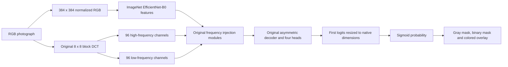

# Methodology and experiment protocol

## Problem and scope

Camouflaged object segmentation predicts a foreground probability at every image pixel when object and background have similar appearance. This project builds on Liang et al.'s original FINet, IEEE Signal Processing Letters 31 (2024), 526–530, DOI https://doi.org/10.1109/LSP.2024.3356416 . The original repository is https://github.com/CRRCOO/FINet at inspected commit `9e42b6bf607a2c89823f5f88dd8d38069039102e`.

The project contribution under investigation is a training-only boundary objective and an application/evaluation workflow. FINet and EfficientNet-B0 are prior work. The unavailable authors' segmentation checkpoints are not used: our encoder starts with torchvision ImageNet weights, and the remaining FINet parameters start randomly. No improvement over FINet is assumed.

## Preserved inference architecture

Use `FINet(backbone='efficientb0', channels=(8,24,32,64))`. RGB is resized bilinearly and ImageNet normalized. The separate frequency branch retains the original uint8-to-YCbCr transformation, 8×8 orthonormal DCT, coefficient ordering, bundled normalization statistics and frequency partition. High and low tensors have 96 channels each at 48×48 for a 384×384 input. Encoder features have channels 16/24/40/112/320. All four heads emit one-channel logits at input resolution.

The first head follows the original inference path: resize logits to the original image dimensions with bilinear interpolation/align_corners=True, then apply sigmoid. Store raw float probability; avoid per-image min/max normalization. Thresholding and overlays are display operations. Inference has 3,742,988 parameters in both experiments.

## Training objectives

Model A uses the exact imported upstream `train.structure_loss` summed across all four heads. The upstream BCE reduces to a scalar before spatial weighting, so the BCE weighting cancels algebraically; its IoU term remains weighted. This behavior is documented and preserved to keep the baseline faithful.

For Model B let `P=sigmoid(logits)` and define a local morphological boundary:

`B(P) = max_pool(P, k=3) - min_pool(P, k=3)`.

Minimum pooling is implemented as the negative maximum pool of the negated probability. Pooling ignores positions outside the image, so a constant full foreground does not acquire an artificial training boundary at the frame. The target boundary uses the same operation on the resized mask binarized at 0.5. Only this target is detached/binarized; the predicted probability remains differentiable. The original soft mask still reaches the original structure term unchanged.

For each head the boundary objective is binary cross entropy plus smoothed Dice loss between predicted and target boundary maps. Four head terms are summed:

`L_B = sum_i structure_loss(logits_i, mask) + lambda * sum_i boundary_loss(logits_i, mask)`.

The initial exploratory lambda is 0.1. BCE inputs are clamped for finite FP32 arithmetic; Dice smoothing is 1. Empty/full target behavior and extreme logits are tested. Lambda zero exactly reproduces baseline values and gradients. No boundary module or additional parameter exists in inference. The display boundary and evaluation boundary definitions are separate, explicitly documented operations.

## Dataset protocol

Use the official SINet-V2-linked training release: 3,040 camouflaged COD10K training images and 1,000 CAMO training images. Preserve original filenames, image/mask bytes and provenance. The audit checks dimensions, matching stems, source counts, readability, mask values and content hashes. Two original grayscale CAMO masks are preserved for structure loss; two duplicate-image pairs remain in one split. Fix a dataset-stratified seed-123456 holdout of 3,636 train / 404 validation pairs. The canonical manifest fingerprint is recorded in the runbook and every checkpoint.

Validation chooses the lowest native-probability MAE checkpoint. Final test data is never used to tune lambda, thresholds, learning rate or model selection. The downloaded test release contains CAMO 250, CHAMELEON 76, COD10K 2,026 and NC4K 4,121. Two CHAMELEON geometry mismatches and seven COD10K development overlaps are explicitly excluded and reported. Scores on these audited subsets must not be described as unchanged standard benchmark scores.

## Controlled comparison

Both experiments load the same complete pre-smoke FINet initialization, including randomly initialized decoder/frequency/head tensors and normalization buffers. Record a semantic state digest in addition to file hashes. Keep the same manifest, augmentation, batch size, seed, optimizer, learning-rate schedule, precision, runtime choices and completed training budget. The intended difference is the additional boundary term.

Perform independent engineering smoke/recovery checks for A and B. Save optimizer, scheduler and random-generator states, actual logs and regular Drive checkpoints. Record interruptions and selection epochs. Compare both selected checkpoints and, where needed, the same completed epoch; different selected epochs are a disclosed model-selection outcome rather than proof of identical training budgets. Do not assert a controlled comparison if the audit flags unmatched initialization, data or settings.

## Metrics and timing

- S-measure: PySODMetrics on native raw probability and matching binary ground truth, without per-image min/max normalization; larger is better.
- MAE: mean absolute difference between native raw probability and binary ground truth, averaged per image; smaller is better.
- Boundary F-score: project-defined inner one-pixel 8-neighbour boundary, Euclidean matching within two native pixels, precision/recall harmonic mean. Both empty boundaries score 1; only one empty boundary scores 0. Larger is better. This tolerance/protocol must accompany the results.
- Parameters: learned model parameter count, identical architecture in A/B.
- Latency: measured device-synchronized forward time after declared warm-up, with mean/median/p95 and hardware recorded. Application end-to-end time includes preprocessing/postprocessing and is reported separately.

Report per-dataset/per-image records, the exact evaluation subset and sample outputs, and real plots only after execution. A few finite training steps establish software execution, not accuracy or a research improvement. Current engineering evidence is in `GPU_TRAINING_VERIFICATION.md`; final A/B results remain pending until actual training/evaluation finishes.
